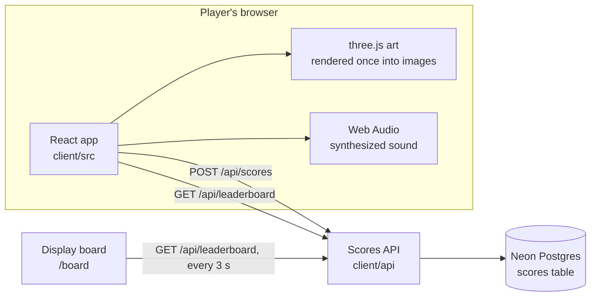
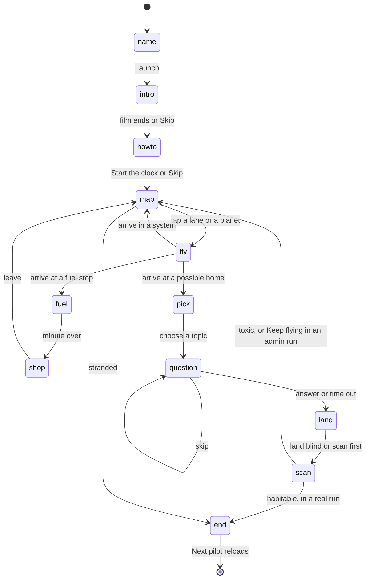

# How Nova Grid works

A guide for developers: how the code is laid out, how a run moves through it, and how scores get to the board. For running it locally, see the [README](../README.md#quick-start).

## The big picture



The game is a single-page React app built with Vite. The scores API is two small handlers in `client/api`: Vite serves them during development, and Vercel runs them as serverless functions in production. Scores are stored in Neon Postgres. Nothing else runs on a server.

**Stack:** React 19, Vite 8, three.js, the Neon serverless driver, and the Orbitron and Space Grotesk fonts from Fontsource. There's no router or state library; one component file holds the game.

## Code map

| Path | What's in it |
|---|---|
| `client/src/main.jsx` | Mounts the app. |
| `client/src/App.jsx` | Everything on screen: the app root (the game at `/`, the board at `/board`), the `Game` component that runs a run, the registration screen, the star map and system map, the tips, the fuel games, the shop, the landing screens, the end screen, the board and the admin panel. |
| `client/src/styles.css` | All the styles. Design tokens (colours, type sizes, radii) are at the top. |
| `client/src/game/rules.js` | Every rule and number, as pure functions: costs, landing odds, points, ranking, the shop, the fuel price. |
| `client/src/game/rules.test.js` | Tests for the rules, the star chart, the fuel games, the flight events and the question bank. |
| `client/src/game/map.js` | The star chart: systems, lanes, planets, orbits and names. |
| `client/src/game/fuelRounds.js` | The ten fuel games' settings, and the card makers for the games that use choice cards. |
| `client/src/game/events.js` | The flight events. |
| `client/src/data/questions.json` | The question bank. |
| `client/src/intro/` | The intro film: `Intro.jsx` picks the 3D film (`Intro3D.jsx`) or the 2D fallback (`ClassicIntro.jsx`, drawn by `draw.js` and `space.js`). `HowTo.jsx` is the How to play reel, and the clips the tips loop. |
| `client/src/three/` | three.js: `sprites.js` renders the map art (and builds planets for the live views), `artStore.js` hands it to React, `PlanetView.jsx` is the live planet with the ship circling it and the landing film, `models.js` builds the ships and station, and `planetMaterial.js`, `glsl.js`, `particles.js`, `post.js` and `assets.js` support the renders and the films. |
| `client/src/art/` | Vector art: stars, planets, the ship, the station, icons, the space backdrop and the warp tunnel. `sky.js` holds the seeded maths for a system's asteroid belt, moons and comets (with a test), and `rng.js` the seeded random numbers. |
| `client/src/sound.js` | Every sound effect and the engine hum, synthesized with Web Audio. |
| `client/api/` | The scores API: `scores.js` (save a run), `leaderboard.js` (read the board) and `store.js` (database connection, table setup, input checks). |
| `client/public/textures/` | Planet textures and the sky panorama. |

## A run's state

The whole run lives in one plain object, `game.current`, held in a React ref in the `Game` component. `fresh()` creates it for a new run. Every change goes through `commit(patch)`, which merges the patch into a new object and triggers a render. Event handlers read `game.current`, which is always current; rendering reads a snapshot of it, `snap`.

The main fields:

| Field | Meaning |
|---|---|
| `phase` | Which screen the run is on (see below). |
| `name`, `phone`, `cheat` | Who's flying. `cheat` is true for an admin run. |
| `here`, `system` | Where the ship is: a system or the station on the star map, or a planet inside `system`. |
| `scanned` | The places scanned from, which decide the lanes the star map shows. |
| `fuel`, `power`, `credits` | The three resources. |
| `variable` | The fuel price multiplier. It starts at 1, and wrong answers usually raise it. A rise is held down only to keep the cheapest lane out payable when the tank could pay for it before (`affordableVariable`); with a tank that couldn't, the rise stands in full. |
| `deadline` | When the clock runs out, as a timestamp on the game clock (`game/clock.js`): the wall time at page load plus `performance.now()`, so changing the device's clock mid-run moves nothing. |
| `visited`, `closed` | Planets landed on, and planets that can't be visited again. |
| `flight` | The flight in progress: where from and to, its path, and its event if it has one. |
| `landing`, `scan`, `card` | The landing chance, the readings after a landing, and the current question. |
| `fuelRound`, `fuelDeck`, `fuelAnswers`, `fuelDeadline` | The fuel minute in progress. |
| `tipsSeen`, `tipAt`, `pausedMs` | Which tips have been shown, and the clock pause while one is open. |
| `admin` | The admin panel's switches (admin runs only). |
| `runId`, `postState` | The saved run's id and whether it reached the board. |

### Phases



Any phase of the run can also end in `end` when the clock runs out, except a landing that settled: the clock can't take that win away while its readings show. Every landing goes to `scan`: a landing film (2.6 s, `DESCENT_MS`) when WebGL and motion allow, then the readings one by one. When they come back habitable, a real run ends (`finish("win", scan.at)` counts the time from the moment Land was pressed, so the film and the readings cost no points), and an admin run is offered **Settle here** (to `end`) or **Keep flying** (to `map`). A toxic landing returns to `map` with its 30 s taken off, and the film's seconds handed back.

### Timers

- A 100 ms interval refreshes the clock on screen.
- Effects schedule the run's end at `deadline`, the question's time-out at 60 seconds, and the end of a fuel minute.
- Inside a system, an interval recharges 1 power every 20 seconds, up to 10.
- After every move, an effect checks whether the ship is stranded.

### Tips

`tipFor(g)` decides which first-time tip a screen shows: the star map, a solar system, a fuel stop or a possible home. While a tip is open, the clock is paused. Closing it moves the deadlines forward by the time it was open.

### Admin runs

The admin panel's switches live in `g.admin`, and each is read in one place:

| Switch | Read in |
|---|---|
| Endless fuel, power and credits | `commit()` |
| A set clock | `roundMs()` |
| Jump anywhere | `moves()` and `launch()` |
| Forced landings | `land()` |
| The next flight event | `launch()` |
| Show answers | `ChoiceButtons` |

## Maps and flights

- **The star map** is an SVG with a pannable, zoomable view. `map.js` holds one fixed chart: 21 systems in three rings around the station, 52 planets (14 possible homes and 38 fuel stops), and the lanes between them. Each page load rotates the chart, mirrors it half the time and shuffles the names, so every player gets the same map without being able to pass a route on.
- **A lane's fuel cost** is the price multiplier × the lane's length × 0.5 (`fare()`). Lanes are 10 long from the station, and 16, 24 or 32 when they reach the inner, middle or outer ring.
- **The system map** is an SVG with the planets on tilted oval orbits. Their positions are a function of time (`orbitAt()`), so hop costs change as they move. A hop aims at where the planet will be when the ship arrives, and curves around a black hole instead of crossing it.
- **Lane flights** play the full-screen warp tunnel (`art/WarpTunnel.jsx`), or a plain flight across the chart under reduced motion. Hops fly the ship along an SVG path.

## Rendered art

When the page loads, if WebGL is available, `renderMapArt()` in `three/sprites.js` renders every planet, each kind of star, the black hole, the asteroids, the ship and the station once with three.js, and turns them into images. `artStore.js` publishes the images, and components read them with `useArt()`. Until they're ready, or without WebGL, the maps use the vector art in `client/src/art/`.

Some screens also run a live three.js view (`three/PlanetView.jsx`), in a transparent canvas over the still picture, which stays under it until the first frame: the screens at a world show the planet turning with the ship circling it, and the landing film (`mode="landing"`) is a full-screen layer behind the Scan and win screens. The film follows the game clock from `scan.at`, so it needs no state from the screens over it, and its sky, haze and scan ring follow the verdict's time. Phones keep the still pictures for the world screens, and nothing live runs under reduced motion or without WebGL. Planet order cards use `art.worlds`, pictures of the eight planets rendered by `renderWorlds()` in `sprites.js`.

The 3D intro film is a live three.js scene in one continuous camera move. Its timeline constants and captions are at the top of `Intro3D.jsx`. If WebGL is missing or the textures take more than 9 seconds, it falls back to the 2D film. Under reduced motion, both are skipped.

## Sound

Every sound is synthesized with Web Audio in `sound.js`; there are no audio files. `sfx(name)` plays an effect, and `engine(level)` sets the ship's hum. Whether sound is muted is remembered in local storage (`nova-muted`).

## Scores

When a run ends (and it isn't an admin run), the game:

1. gives it a `runId`,
2. adds it to a queue in local storage (`aais-pending-scores`),
3. posts everything in the queue to `/api/scores`, and retries every 4 seconds until the queue is empty, even across reloads.

The server ignores a `runId` it has already saved, so retries never save a run twice. The end screen then reads `/api/leaderboard?run=<runId>`, which returns the top 10 plus that run's own row and rank.

### API

**`POST /api/scores`** saves one run:

```json
{
  "runId": "3f0c…",
  "name": "Ananya",
  "phone": "9876543210",
  "settled": true,
  "timeLeft": 250,
  "worlds": 3,
  "fuel": 18,
  "finishedAt": "2026-11-07T10:15:00.000Z"
}
```

It answers 201 with the saved row, 200 with `{ "duplicate": true }` for a repeated `runId`, 400 for bad input (the error says which field), 503 when no database is set, and 500 if the database fails.

**`GET /api/leaderboard`** returns the top 10, ranked like the board. With `?run=<runId>`, it adds that run's row, with its `rank`, the `total` number of runs, and `mine: true`. Phone numbers are never returned.

### Database

The `scores` table is created, and updated with any new columns, on the first request:

| Column | Type | Meaning |
|---|---|---|
| `id` | integer | Row id. |
| `name` | text | Pilot's name, up to 40 characters. |
| `phone` | text | Digits only, 10 to 15. For contacting prize winners. |
| `run_id` | text, unique | The run's id, so a retry can't save it twice. |
| `settled` | boolean | Whether the run was won. |
| `time_left` | integer | Seconds left at the end. |
| `worlds` | integer | Planets visited. |
| `fuel` | double | Fuel left at the end. |
| `finished_at` | timestamptz | When the run ended. |
| `score`, `roll_no` | | Left over from earlier versions. New runs don't write them. |

Where the database is depends on `DATABASE_URL`:

- **Production:** set in the Vercel project's settings, pointing at Neon's `production` branch.
- **Local development:** `client/api/store.js` loads it from `.env.local` at the repo root, which points at the `dev` branch.
- **No database:** start Vite with an empty `DATABASE_URL`, and the API answers 503.

## Tests

```bash
cd client
npm test
```

This runs `src/game/rules.test.js` (rules, landing odds, ranking, the shop, the fuel price, the star chart, the fuel games, the flight events and the question bank) and `api/parse.test.js` (the API's input checks) with Node's built-in test runner.

## Deploying

```bash
cd client
npx vercel --prod
```

The `client` folder is linked to the Vercel project (`client/.vercel`). Vercel builds with `npm run build`, serves `client/dist`, runs `client/api` as functions, and sends every other path to the app (`vercel.json`). Production is at <https://client-ten-phi-98.vercel.app>.

Day-to-day work happens on the `experimental` branch. `main` is kept as the last known-good version to roll back to.

## Conventions

- **Numbers belong in `rules.js`**, with a test. The How to play reel reads its numbers from the rules, but its captions and scenes are written by hand, so check them after changing a rule.
- **Every animation has a still version.** Reduced motion skips the intro film, shows the reel as stills and leaves out Asteroid tap.
- **The look:** navy, with Orbitron for display type and Space Grotesk for body text. Use the tokens at the top of `styles.css`.
- **Commits:** small, one change each, and each one builds and passes the tests.
